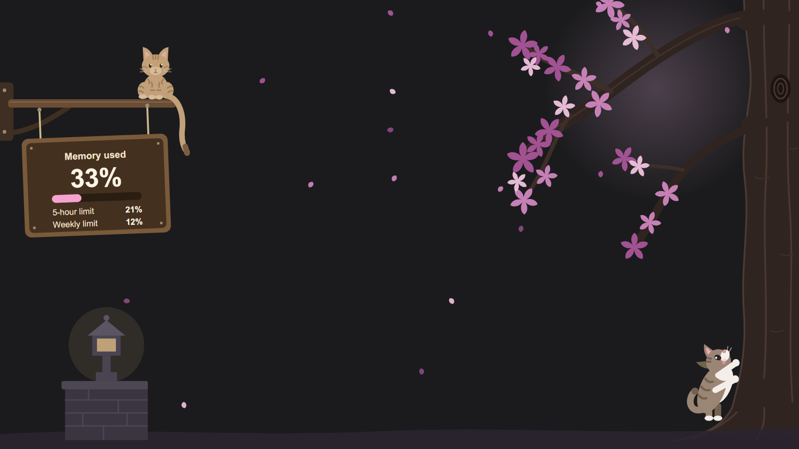
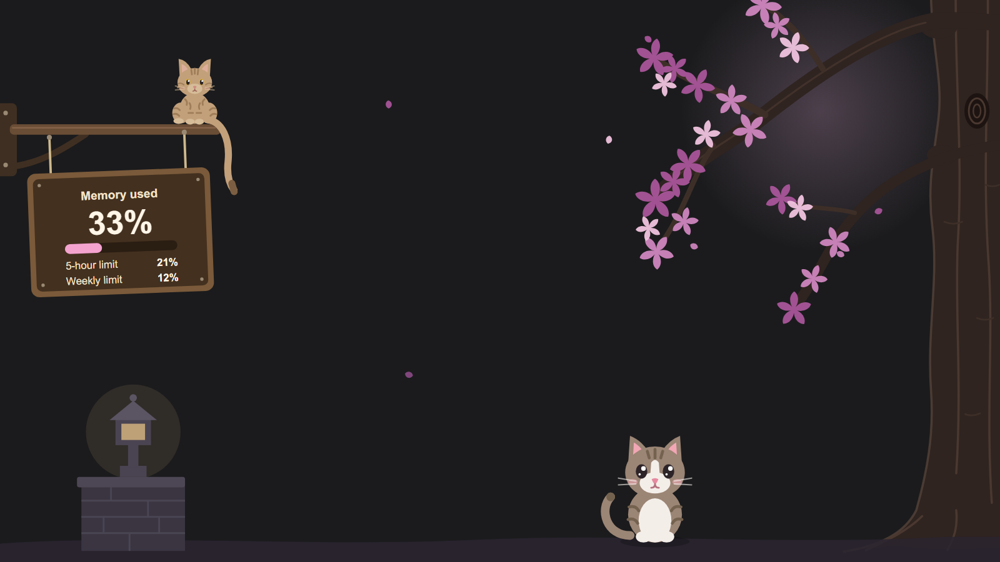

# plum-sakura

A theme mod for the Claude desktop app. It draws a plum sakura scene behind your session and shows how much of your context window and plan limits you have used.





_These are renderings of the scene on its own, without the chat panels in front of it. The sign shows sample numbers._

- **Scene:** dark bark branches and a gnarled trunk, with plum and pink blossoms, a pale moon, and petals drifting down. Your app's own dark grays stay as they are, and only the accent colors are plum.
- **Wind that follows Claude:** while Claude is working, the branches sway harder, more petals fall, pale wind strokes sweep across, and a cat walks between a stone lantern wall and the trunk. She bumps the walls, turns around, and every so often tries to climb the trunk. Between turns she rests (sitting, grooming or sleeping).
- **Hanging sign:** in the top-left corner a tabby lounges on a bracket above a swinging sign showing context window use as a percentage with a pink bar, plus your 5-hour and weekly limits when your plan reports them.
- **Toasts:** a note appears when the context window passes 80% and 95%.

The scene is plain SVG with CSS animation, and it honors the reduced-motion setting.

## Install

At the prompt of a terminal session:

```
/plugin install plum-sakura --marketplace ananyascodehq/plum-sakura
```

From a shell:

```
claude plugin install plum-sakura --marketplace ananyascodehq/plum-sakura
```

In the desktop app, where `/plugin` does not run: click + next to the prompt box, then Plugins, Add marketplace with `ananyascodehq/plum-sakura`, then Add plugin.

Themes draw in the desktop and mobile apps only. The terminal and editors draw no theme.

## Files

- `hooks/register.tsx`: the whole mod (scene, cat, sign, wind, usage readouts).
- `hooks/make-colors.js`: the engine's color helper, copied unchanged.
